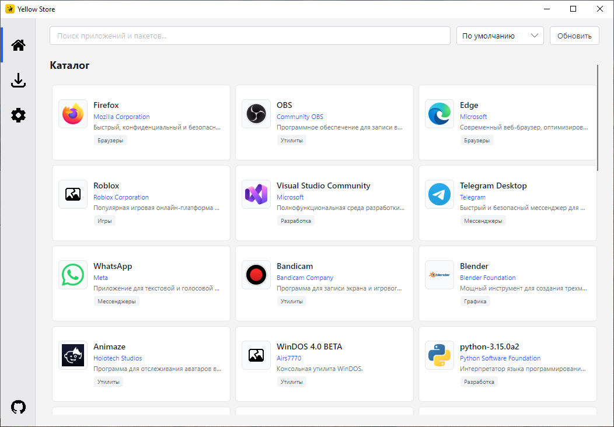
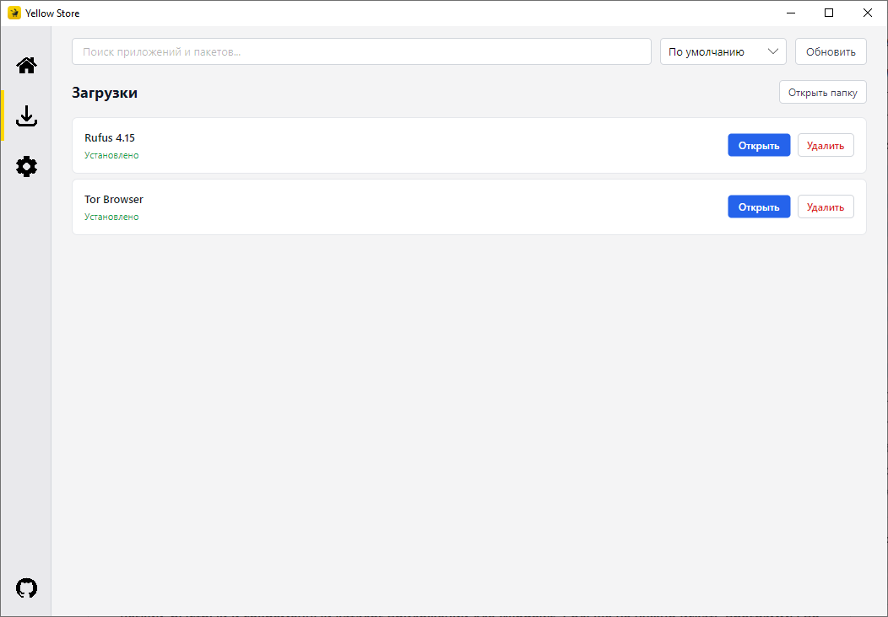
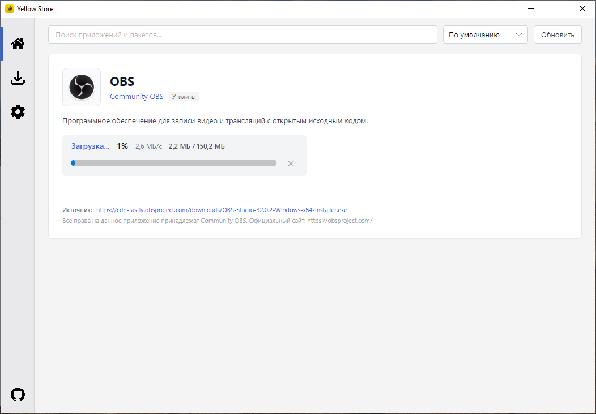
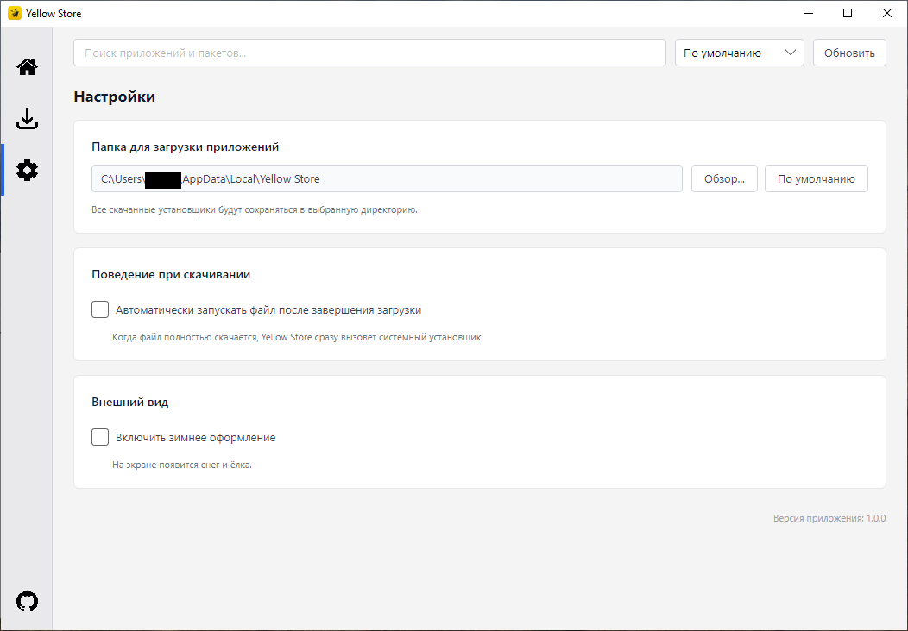

  
  
  # Yellow Store
  
  **Легкий, быстрый и современный каталог приложений для Windows. Больше не нужно искать программы по всему интернету, входить в аккаунты и рисковать, скачивая вирусы со случайных сайтов.**
  
  
  
  
  

   
  
  [**Скачать**](https://github.com/yellow761/Yellow-Store/releases/latest) &nbsp;&nbsp;·&nbsp;&nbsp; [**Предложить приложение**](https://github.com/yellow761/Yellow-Store/issues/new?template=add_app.yml) &nbsp;&nbsp;·&nbsp;&nbsp; [**Сообщить о баге**](https://github.com/yellow761/Yellow-Store/issues/new?template=bug_report.yml)

---

## 🖼️ Скриншоты

  
   
  <i>Главный экран — Каталог приложений</i>

 

  
   
  <i>Вкладка загрузок с прогресс-баром</i>

 

  
   
  <i>Процесс установки приложения</i>

 

  
   
  <i>Настройки программы</i>

---
